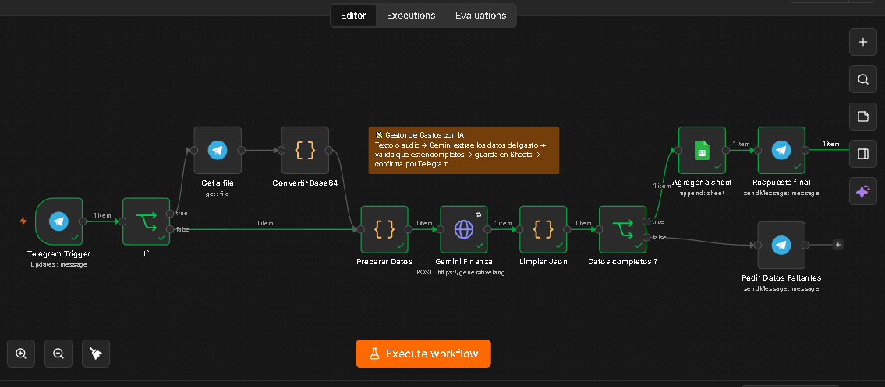

# 💸 Finanzas con n8n

Asistente automatizado que registra gastos personales por **texto o audio** en Telegram. Usa **Gemini (IA)** para interpretar el mensaje y extraer los datos del gasto, valida que estén completos y los guarda automáticamente en **Google Sheets**, confirmando el registro por Telegram.



## 🎯 ¿Qué hace?

1. Le escribís o le mandás un audio al bot de Telegram contando un gasto (ej: *"Gasté 8500 en el supermercado con débito"*).
2. **Gemini** interpreta el mensaje y extrae: fecha, categoría, descripción, monto, moneda y método de pago.
3. Si falta información clave (por ejemplo, no se entendió en qué se gastó), el bot te pide que repitas el gasto con más detalle, **sin guardar registros incompletos**.
4. Si los datos están completos, se guarda una fila nueva en Google Sheets y el bot te confirma el gasto registrado.

## 📂 Categorías

🍔 Alimentación · 🛒 Supermercado · 🚗 Combustible · 🚌 Transporte · 🏠 Hogar · 💡 Servicios · 💊 Salud · 👕 Ropa · 🎮 Entretenimiento · 📱 Tecnología · 📚 Educación · 💰 Otros

## 🛠️ Tecnologías

- [n8n](https://n8n.io/) (self-hosted, Docker)
- [Gemini API](https://ai.google.dev/) (Google AI Studio)
- Telegram Bot API
- Google Sheets (vía cuenta de servicio)
- Cloudflare Tunnel (para exponer el webhook en desarrollo local)

## 🚀 Cómo levantarlo

**Necesitás:** Docker Desktop, un bot de Telegram (token de [@BotFather](https://t.me/BotFather)), una API key de [Google AI Studio](https://aistudio.google.com/) para Gemini, y una cuenta de servicio de Google Cloud con la Sheets API habilitada.

1. **Cloná el repo y levantá n8n:**
   ```bash
   git clone <url-de-este-repo>
   cd Finanzas_con_N8N
   cp .env.example .env
   docker compose up -d
   ```
   Entrá a `http://localhost:5678` y creá tu usuario owner.

   > Si corrés n8n en tu compu (no en un servidor con dominio propio), vas a necesitar un túnel (ej: [cloudflared](https://github.com/cloudflare/cloudflared/releases/latest)) para que Telegram y Google puedan enviarle datos. La URL que te dé el túnel va en `WEBHOOK_URL` dentro de `.env`.

2. **Importá el workflow:** en n8n, `Workflows → Import from File` → `Workflow_Finanzas.json`.

3. **Cargá las credenciales:** los nodos en rojo te van a pedir crear la credencial de Telegram (el token de BotFather) y la de Google Service Account (`client_email` y `private_key` de tu archivo `.json`, [ver cómo](https://docs.n8n.io/integrations/builtin/credentials/google/service-account/)). Acordate de **compartir tu Google Sheet** con el email de la cuenta de servicio como Editor.

4. **Completá dos datos:**
   - En el nodo **Gemini Finanza**: tu API key en la URL, donde dice `TU_API_KEY_AQUI`.
   - En el nodo **Agregar a sheet**: el ID de tu planilla, donde dice `TU_SHEET_ID_AQUI` (aparece 2 veces).

5. **Preparar la planilla:** creá una Google Sheet con estas columnas en la primera fila:
   | Fecha | Categoria | Descripcion | Monto | Moneda | MetodoPago |
   |---|---|---|---|---|---|

6. Activá el workflow y escribile a tu bot. 🎉

## ⚠️ Notas

- Con la versión gratuita de Cloudflare Tunnel, la URL pública **cambia cada vez que reiniciás el túnel** — hay que actualizar `WEBHOOK_URL` y recrear el contenedor cuando eso pase. Para un uso más estable, considerá un túnel con dominio fijo o un servidor con IP/dominio propio.
- El flujo no mantiene memoria entre mensajes: si el bot te pide más datos, hay que reescribir el gasto completo en un solo mensaje nuevo.

## 📝 Créditos

Basado en un proyecto práctico del curso de IA y automatización de la Universidad Nacional de Córdoba, adaptado y mejorado con categorías automáticas, validación de datos completos, moneda y método de pago.
